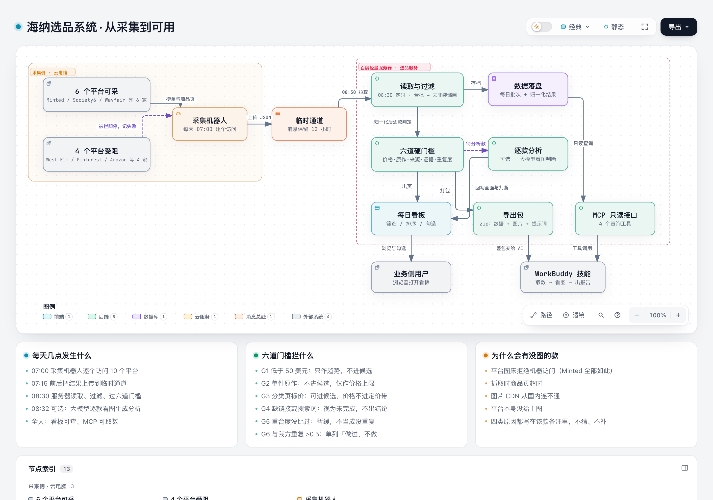
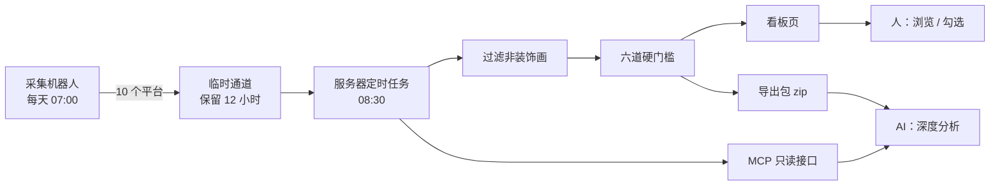

# 海纳选品系统 · 系统全貌

> 这份文档说明本技能依赖的那套服务是怎么跑的。技能负责「怎么用」，这里负责「数据从哪来、每天几点更新、哪些地方会缺、缺了意味着什么」。

> 想看带动效的交互版本：下载本仓库后打开 `assets/selection-system-overview.html`。

## 一、定位

每天从 10 个海外装饰画平台自动采集新品，过滤掉非装饰画，过六道硬门槛，产出看板和只读数据接口。

产出是**证据层**，不替代业务侧签发的打样建议。机器不凑数推款：当天不够线就是「今天不做」。

## 二、整体链路

## 三、组件

| 组件 | 说明 |
| --- | --- |
| 采集 | 云电脑上的浏览器机器人，每天 07:00 逐个访问 10 个平台 |
| 通道 | 临时消息通道，消息只保留 12 小时，过期即失效 |
| 管线 | 选品服务器上的定时任务，08:30 自动跑：读取 → 合并 → 过滤 → 门槛 → 出页 |
| 看板 | 每日一个 HTML 页面，支持筛选、排序、日期切换、勾选导出 |
| MCP | 只读数据接口，本技能通过它取数 |
| 导出 | 选中若干款打包成 zip（JSON + Markdown + 图片 + 给 AI 的提示词） |

服务地址与访问令牌由管理员单独分发，**不写入本仓库**。

## 四、每日时间线（北京时间）

| 时间 | 发生什么 |
| --- | --- |
| 07:00 | 开始采集，10 个平台逐个访问 |
| 07:00–07:15 | 每平台 1 次列表页 + 最多 3 次商品页；碰到拦截立刻停，记失败，不重试 |
| 07:15 左右 | 结果上传通道；失败的平台如实记入台账 |
| 08:30 | 服务器读取、合并拆批、过滤、过门槛、生成看板与导出包 |
| 08:32 左右 | 若配置了大模型，逐款生成分析并重新出页 |
| 全天 | 看板可浏览、勾选、导出；MCP 可随时查询 |

## 五、数据契约

`get_items` 返回的每款字段：

| 字段 | 含义 | 缺失时 |
| --- | --- | --- |
| `id` | 编号（平台缩写 + 序号） | 必有 |
| `platform` | 平台名 | 必有 |
| `title` / `title_cn` | 原标题 / 中文名 | `title_cn` 可为 null |
| `artist` / `artist_cn` | 艺术家原文 / 中文名 | 可 null |
| `url` | 商品详情页 | 必有 |
| `price_usd` | 美元价 | 可为 null，**不估算** |
| `size_in` | 尺寸，如 `16x20` | 可为 null |
| `reviews` | 评论数 | 可为 null |
| `image_url` | 商品图直链 | 可为 null，附 `image_note` 写明原因 |

**三条铁律**：null 不等于 0；缺尺寸或缺价的款不进定价带；低于 50 美元只作趋势信号，不进打样候选。

## 六、六道硬门槛

| 编号 | 内容 | 不通过时 |
| --- | --- | --- |
| G1 | 价格下限（<50 美元） | 只作趋势，不进候选 |
| G2 | 原作排除 | 不进候选，仅作价格上限参考 |
| G3 | 价格来源（分类页标价） | 可进候选，但价格不进定价带 |
| G4 | 证据完整（链接或站内搜索词） | 视为未完成，不出结论 |
| G5 | 重复覆盖未知 | 暂缓，进待补清单（未知 ≠ 没重复） |
| G6 | 与我方在售重复（重合度 ≥ 0.5） | 单列「做过、不做」 |

## 七、MCP 工具

| 工具 | 作用 | 参数 |
| --- | --- | --- |
| `list_days` | 有哪些日期有数据（新的在前） | `limit` |
| `get_items` | 按日期拉当天全部新品 | `date` / `platform` / `min_price` / `max_price` / `keyword` / `limit` |
| `get_item` | 单款完整资料 | `id` / `date` |
| `export_zip` | 把指定款打包成 zip，返回下载地址 | `date` / `ids` |

只读令牌可调用以上全部；调用写工具会被拒绝并返回明确提示。

## 八、为什么会出现「没有图」

按出现频率：

| 原因 | 表现 | 能不能补 |
| --- | --- | --- |
| 平台图床拒绝机器访问 | 该平台全部款式无 `image_url` | 只能人工打开商品页看 |
| 抓取时页面超时 | 单款无图，`image_note` 写明超时 | 下次可能恢复 |
| 图片 CDN 从国内连不通 | 下载失败但链接存在 | 有海外网络时可打开 |
| 平台本来就没给主图 | 极少 | 无法补 |

**没有图不代表这款不好**，只代表机器没拿到画面。技能侧的处理原则是：无图款必须照常列出、给出商品页链接、明确标注「未见图」，不要靠标题硬猜。

## 九、已知限制

- Amazon 从 2026-11-24 起对采集出口返回 Access restricted，尚未恢复
- Minted 图床对机器访问一律 403，该平台款式没有图片直链
- 与在售盘的重合度目前普遍为 null，导致多数款停在「补数据可过」
- 接口与看板走 HTTP 明文，上 HTTPS 需要域名
- 目前是单一只读令牌分发，尚未做「一人一把」
